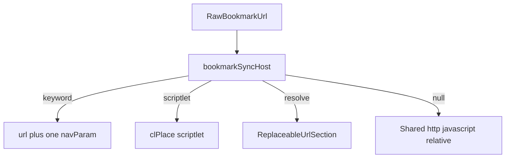

# Firefox keyword URLs and place: bookmarks

Amends [bookmark_sync_feature_28719d91.plan.md](.cursor/plans/bookmark_sync_feature_28719d91.plan.md). Schema is v3: URL substitution uses `navParams` ([CONTEXT.md](CONTEXT.md), [ADR 0001](docs/adr/0001-params-vs-navparams.md)). Do not write a `params` key.

## What this adds

- A bookmark URL containing `%s` and/or `%S` imports as a non-scripted dynamic link: `url` + one user-input `navParam`. No `__clDerive__` wrapper.
- Export may **create** that bookmark URL only when the link has exactly one `navParam`, and that param is user-input only (no `fromUrl`, no `fromSelector`, not `type: "boolean"`). The template may use `{name}` and/or `{encode:name}` and must not contain `{origin}` or any other token.
- Derived params disqualify the keyword form. Those links stay on the existing `__clDerive__` path.
- A `place:` bookmark uses an advanced treatment preference: snapshot section, or a scriptlet that queries and shows an overlay and syncs back to the `place:` URL.
- Defaults and every other `navParam` field a bookmark cannot store stay on the extension node across bidirectional sync.

## API limit

`browser.bookmarks` exposes `title` and `url` only. The address-bar keyword string is not readable or writable (Firefox bug 1276817, never shipped). Sync the URL, not the keyword.

- Update a mapped bookmark with `bookmarks.update(id, { url })`. Recreate-on-export would drop a keyword the user set in Firefox, because the keyword is stored on the bookmark item, outside this API.
- A link that did not already have a Firefox keyword gets a `%s` / `%S` URL and no shortcut. The shortcut is set in Firefox. Say that in the sync status line.

`%s` is not valid percent-encoding. Detect and replace it on the **raw** bookmark URL string. Do not run these URLs through `new URL()` or `url.href` before substitution; a URL parser can turn `%s` into `%25s`.

## Keyword mapping

Firefox substitutes every `%s` and `%S` in one keyword URL with the same typed text. `%s` is encoded; `%S` is raw.

| Bookmark token | Template token |
|---|---|
| `%s` | `{encode:name}` via `encodeURIComponent` in [`applyTemplate`](lib/link-model.js) |
| `%S` | `{name}` |

- New import: param name `q`, `placeholder: "q"` so the sidebar shows an input ([`getEditableNavParamDefs`](lib/link-model.js) treats `placeholder` as the UI opt-in). No `default`. `open: "tab"`, same as other http bookmarks in the existing plan.
- Re-import onto a mapped node: bookmark wins for the literal URL and for encoded vs raw. Reuse the existing param **name**. Keep extension-only fields: `default`, `placeholder`, `optional`, `choices`, `label`, `type`, `open`, `match`, and any derivation keys already on that param. Absence of those fields on the bookmark is not a delete.
- First import has nothing to keep. A default added later in the extension survives the next import.
- Export replaces `{encode:name}` first, then `{name}`, so the encode form is not partially rewritten. Both tokens may appear. Several `%s` / `%S` still mean one param.
- Two or more user-input params: do not emit a keyword URL.
- `open` is not written into the bookmark. Firefox click behavior ignores it. The extension keeps its own `open`.

Import order in the shared converter: `__clDerive__` → `__clNav__` → plain `javascript:` → host specials (keyword, then `place:`) → `http(s)` → relative path → skip other schemes.

Export order: host specials first (keyword URL or `place:` URL), then the existing `__clNav__` / `__clDerive__` / plain URL / plain scriptlet paths.

## Advanced treatments

Complex Firefox conversions get a preference instead of one hardcoded shape. The sync settings page (planned `sync/sync.html`) has an **Advanced** group. It renders whatever `host.advancedPreferences()` returns. The Firefox host returns one control today. A null host returns none, so the Chromium page has no `place:` control.

Storage key `bookmarkSyncTreatments`: `{ place: "resolve" | "scriptlet" }`. Default `resolve`.

Another complex feature later is another key on that object and another entry from the host. Shared sync code stores and forwards the map. It does not name `%s` or `place:`.

Switching the preference applies on the next sync **from the browser**. Resolve removes the scriptlet leaf and writes the snapshot section. Scriptlet removes the snapshot section and writes the scriptlet leaf.

## place: bookmarks

WebExtensions cannot run a raw `place:` query. The Firefox host maps only the subset `bookmarks` and `history` can answer:

- Bookmark text search (`queryType` bookmarks + `terms`) → `bookmarks.search`
- A folder whose id is a `bookmarks` API id → `bookmarks.getChildren`
- History search (`queryType` history, optional `terms` / `maxResults` / time range) → `history.search` (optional `history` permission, requested when a `place:` query needs it)

Other clauses (tags, annotations, domains, sorts the APIs do not apply, integer folder ids that are not bookmark API ids) are skipped and counted in sync status. The Firefox bookmark is left unchanged.

Page `javascript:` cannot read Places, and `tabs.update` rejects `place:` URLs. Neither treatment uses `location.assign("place:…")`.

### Resolve on sync (default)

At import, query and store the current results as ordinary `{ url, open: "tab" }` leaves. They occupy one overlay **section** named with the bookmark title. `bookmarkSyncState` records `bookmarkId` → section name and `kind: "place-snapshot"`. Section objects cannot hold that flag: [`normalizeCatalog`](lib/link-model.js) keeps only `children`, `match`, and `exclude`.

Each sync from the browser **replaces** that section's children. Edits in the extension are overwritten on the next import. Conflict detection ignores the section.

Bookmark export does not write this section. The `place:` bookmark stays as it is (no update, no child bookmarks, no `javascript:` replacement). JSON export includes the section through the existing overlay export ([`overlayExport`](lib/link-catalog.js)).

A title that matches a bundled section only replaces the overlay children. Bundled children of that name stay, because [`mergeLinksCatalog`](lib/link-catalog.js) concatenates them.

### Scriptlet (query and display)

Import one `code` leaf. The source is a marker the normalizer keeps, carrying the raw URI:

```javascript
/* __clPlace__ place:queryType=1&sort=12&maxResults=10 */
```

`bookmarkSyncState` maps `bookmarkId` ↔ `linkId` with `kind: "place-scriptlet"`.

Activation does not inject that `code` into the page. The Firefox host matches the marker, runs the same query subset, and injects a clickable results overlay on the page (same kind of fixed panel as [`lib/search-overlay-page.js`](lib/search-overlay-page.js), with pointer events so a row can open). Shared [`lib/link-behaviors.js`](lib/link-behaviors.js) stays unaware: the background asks the host before scriptlet inject.

Bookmark export writes that bookmark's `url` back to the `place:` string from the marker. It does not write a `javascript:` URL. If the marker is gone, skip the bookmark write and report it. A broken marker must not replace the smart bookmark with a bookmarklet. A marker that still parses continues to round-trip after other edits to the leaf title.

## Chromium seam

Firefox-only knowledge lives in one module, [lib/bookmark-sync-firefox.js](lib/bookmark-sync-firefox.js):

- `advancedPreferences()` → settings controls, or `[]`
- `importSpecialUrl(rawUrl, treatments)` → keyword leaf, place scriptlet leaf, place snapshot section, or `null`
- `exportSpecialUrl(node, treatments)` → bookmark URL for a keyword link or a `__clPlace__` marker, or `null` (snapshot sections are `null`)

[lib/bookmark-sync-host.js](lib/bookmark-sync-host.js) is the only import of that module. It returns the Firefox adapter. A Chromium build replaces this file with a host that returns `null`. Shared convert and the sync engine call the host and do not mention `%s`, `%S`, or `place:`.

With a null host:

- `%s` in a URL is an ordinary URL string (not a `navParam`)
- `place:` is an unknown scheme and is skipped
- extension nodes are not exported as keyword or `place:` URLs
- the Advanced group is empty



## Compatibility gate

Add to v1 compatible, ahead of `__clDerive__`, when the host returns a URL:

- Single user-input `navParam` keyword form
- `__clPlace__` scriptlet, Firefox export writes the `place:` URL
- Resolve snapshots are ordinary URL leaves for JSON export, and bookmark export skips their section

Null host: keyword conversion and both place treatments are absent, so existing skip / plain-URL behavior applies.

## Tests

Pure tests next to the convert module (no browser):

- `%s` only, `%S` only, both tokens, repeated `%s`, same one param
- Raw string is not passed through `new URL` before replacement
- Re-import keeps `default`, `placeholder`, and `open` while the URL pattern changes
- Two user-input params and a `fromUrl` param do not export a keyword URL
- Resolve: a second import replaces section children; bookmark export returns null for that section; overlay JSON still contains the URLs
- Scriptlet: marker exports the `place:` URL; a missing marker does not export `javascript:`
- Null host: `%s` stays literal, `place:` is skipped, `advancedPreferences()` is empty
